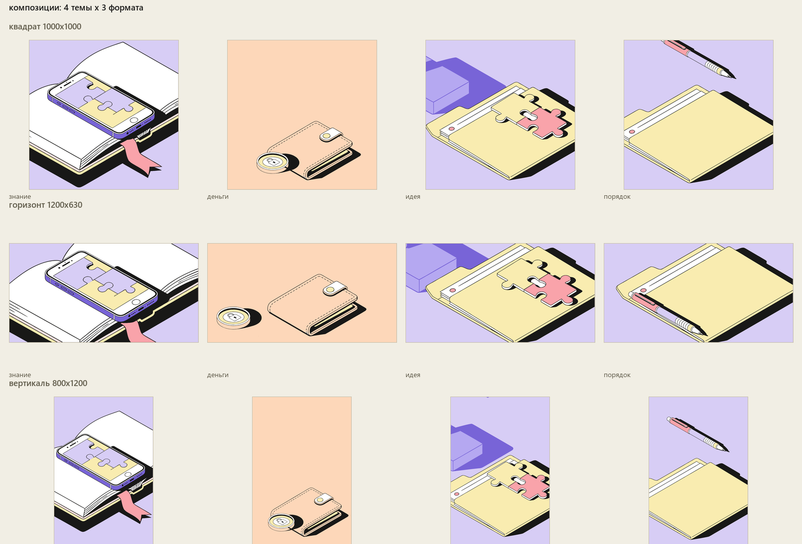

# illustrations

**Демо:** https://illustrations-hk9odkspq-echoisonline1.vercel.app

Сервис, который собирает иллюстрации из фиксированной библиотеки SVG: тема или список объектов на входе, готовый кадр на выходе — векторный SVG или PNG, в одном из трёх форматов и в одной из палитр заказчика.

Библиотека, палитры и форматы взяты из макета как есть: 10 объектов в двух состояниях (цветной и монохромный) и двух размерах.



## Запуск

Нужен Node.js 20+ (проверено на 22.13).

```bash
npm install     # один раз
npm run dev     # http://127.0.0.1:5199
```

Порт зафиксирован в `vite.config.ts`: 5173 на Windows часто занят системной службой.

```bash
npm run build     # статика в dist/
npm run preview   # http://127.0.0.1:4199 — проверить собранное
npm test          # тесты домена
```

## Как собирается композиция

Логика снята с референсов заказчика и разбита на четыре шага. Геометрию считает код, модель участвует только в выборе позы.

**1. Смысл → Scene Graph.** Из брифа вытаскиваются грани темы (`знание`, `деньги`, `идея`…). Берётся не одна победившая, а топ-3: «рабочее место для идей» — это и идея, и работа, и порядок. Каждая грань даёт план сцены: узлы с ролью (`hero`, `support`, `decor`, `detail`) и отдельно `kind` (`main` или монохромный `bg`), плюс связи `on / near / behind / above / below / overlap`.

**2. План → кандидаты раскладки.** Библиотека из двенадцати композиционных поз. Поза сама решает, применима ли она к составу, и расставляет роли по координатам; зеркальный вариант считается отдельным кандидатом.

**3. Проверка ограничений.** Жёсткие правила: главный предмет виден не меньше 60% (45% в широком кадре), крупные предметы не перекрываются без отношения, ни один предмет не ушёл за кадр и не закрыт соседом целиком, в кандидате присутствуют все предметы плана. Нарушивший вариант отбрасывается.

**4. Оценка и выбор.** Скорер считает иерархию, баланс массы, заполнение кадра и совпадение позы с задуманным отношением, затем берётся лучший вариант. Если ни один не прошёл проверку — показывается лучший из имеющихся: сцена не остаётся пустой.

Масштаб всегда единица: предметы стоят в том размере, в котором нарисованы. Один предмет крупнее кадра — норма, обрез краем задуман.

### Поза и модель

Позу выбирает DeepSeek, но только из закрытого списка: имя паттерна и зеркало. Координат модель не касается, выдумать позу не может — ответ валидируется по каталогу. Пока ответа нет, холст показывает спиннер; нет ответа за семь секунд — сцена собирается по правилам. Без ключа всё работает так же, только без модели.

Ключ живёт в `.env.local` и уходит в API через прокси Vite, в бандл он не попадает:

```
DEEPSEEK_KEY=...
```

### Второй сценарий: объекты по названиям

Пользователь пишет `лампа, папка, ручка` — сцена собирается из названных предметов. Здесь состав принадлежит человеку: движок не подменяет и не выбрасывает предметы, а только выбирает позу. Лампа и ваза всё равно уходят в фон.

### Стенд

```bash
node tools/bench.mjs "обучение и курсы" square
```

Рендерит **все** кандидаты темы в `docs/bench/` и пишет `meta.json` с оценками и нарушениями — видно, почему вариант выбран или отброшен.

## Деплой

Проект собирается как обычная статика Vite: `dist/` плюс серверная функция
`api/deepseek/chat/completions` для выбора позы. Vercel определяет всё сам.

**GitHub.** Репозиторий публичный, секретов в нём нет: ключ живёт только в
переменных окружения.

```bash
git remote add origin git@github.com:<аккаунт>/illustrations.git
git push -u origin main
```

**Vercel.** Импортируем репозиторий, ничего в настройках сборки не меняем —
`npm run build` поднимает `prebuild` и собирает спрайты из `assets/source`.

Переменная окружения:

```
DEEPSEEK_KEY=...   # только для продакшена; без неё поза выбирается правилами
```

**Проверить локально перед деплоем:**

```bash
npm run build && npm run preview   # http://127.0.0.1:4199
```

## Что внутри

- `src/domain` — библиотека спрайтов, перекраска по слотам палитры, движок композиции (`compose/`).
- `src/features` — сцена, библиотека, инспектор, палитра, экспорт.
- `src/ui` — мелкие общие компоненты.
- `src/styles/global.css` — оформление и адаптив.
- `assets/source` — исходные SVG из макета (объекты и подложки, размеры L и S).
- `examples/` — собранные композиции, `docs/` — превью интерфейса.

## История

Проект писался по шагам: сначала библиотека и перекраска, потом холст и экспорт, затем движок композиции — от фиксированных координат к плану сцены, паттернам и отбору кандидатов. Логика каждого шага объяснена в сообщениях коммитов.
