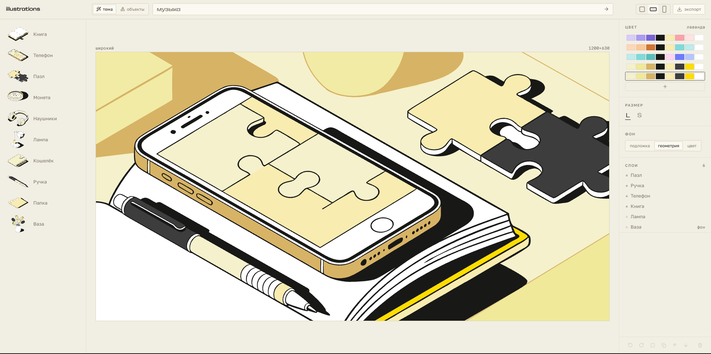
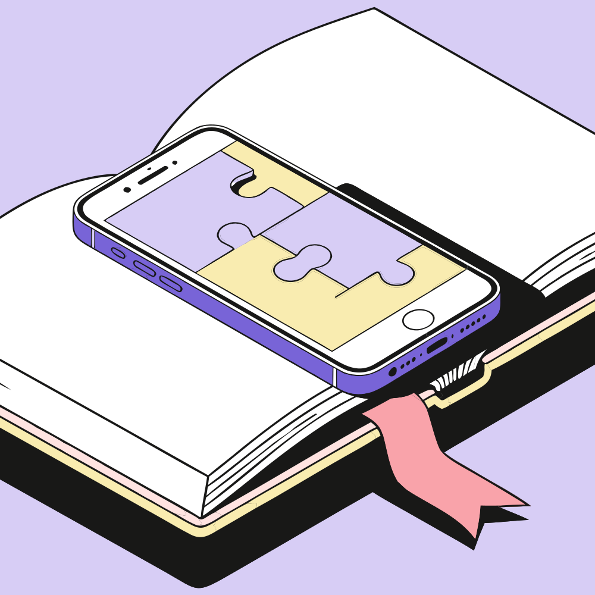
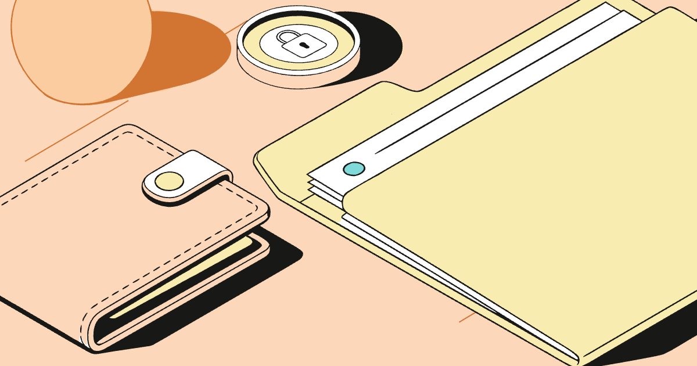
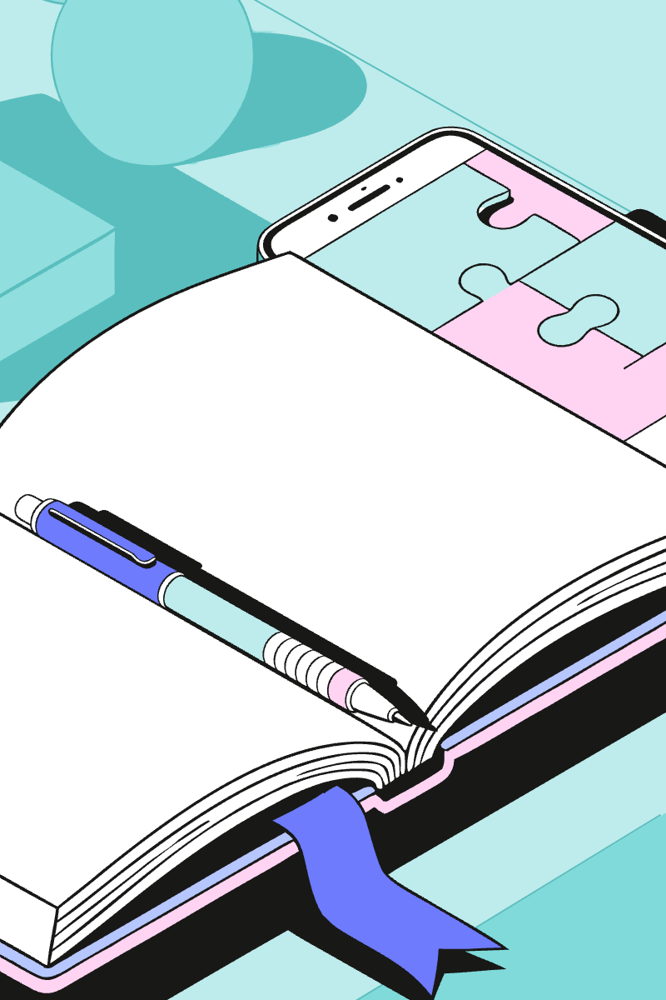

# illustrations

Сервис собирает иллюстрации из фиксированной библиотеки SVG: на входе тема или список предметов, на выходе готовый кадр — векторный SVG или PNG, в одном из трёх форматов и одной из палитр макета.



**Демо:** https://illustrations-pink.vercel.app

## Как запустить

```bash
npm install
npm run dev      # адрес печатает сам Vite
npm test         # тесты на доменную логику
npm run build    # статика в dist/
```

Ключ к модели не обязателен: без него поза выбирается правилами. Если нужен — положите `DEEPSEEK_KEY` в `.env.local`, в бандл он не попадёт.

## Что умеет

- **Готовые формулировки.** Клик по полю ввода открывает примеры для обоих сценариев: темы («обучение и курсы», «деньги и бюджет») и наборы предметов («лампа, папка, ручка»). Один клик подставляет текст, переключает режим и собирает сцену.
- **Сценарий по теме.** «Обучение и курсы», «деньги и бюджет», «музыка и подкасты» — сервис сам решает, какие предметы поставить и как их связать.
- **Сценарий по названиям.** «Лампа, папка, ручка» — сцена собирается из названных предметов, состав не подменяется.
- **Кадры и палитры.** Три формата, два размера, три схемы заказчика и свои палитры; перекрашивается вся иллюстрация целиком.
- **Ручная правка.** Перемещение, поворот ручками в углах, порядок слоёв, дублирование, замена предмета.
- **Экспорт.** SVG и PNG одним окном, без потери векторности.
- **Телефон.** Шторки вместо панелей, форматы и слои доступны на узком экране.

## Как выбирается композиция

### Сценарий по теме

**1. Бриф разбирается на смыслы.** В тексте ищутся темы по словарю: знание, деньги, идея, порядок, ритм, забота, эстетика и так далее. Считается, сколько раз каждая сработала.

**2. Берутся три сильнейшие, а не одна.** Одной почти всегда мало: «рабочее место для идей» — это и идея, и работа, и порядок. Три темы — три разных сцены, из которых потом выбирается лучшая.

**3. Тема превращается в состав.** У каждой темы есть свои предметы: учёба — книга и телефон, деньги — кошелёк и монета, ритм — телефон и наушники. К составу добавляется фон: лампа или ваза, если тема про работу, идею, заботу или эстетику.

**4. Предметы получают роли.** Крупный предмет — герой, второй — поддержка, мелкий (пазл, монета, ручка) — деталь, лампа и ваза — всегда фон. Дальше действуют правила: «положить на» можно только на плоскость (книга, папка, кошелёк, телефон); в кадре не больше трёх предметов; деталь не ставится поверх мелкой поддержки, иначе получается башня.

**5. План превращается в варианты раскладки.** В библиотеке двенадцать поз: взаимодействие, соседство, диагональ, вертикаль, край, наплыв, второй план, угол, парад, крупный план, стопка, одиночка. Поза сама решает, подходит ли она составу, и расставляет роли по координатам. Плюс зеркальный вариант каждой позы.

**6. Варианты проверяются.** Главный предмет виден не меньше 60% (в широком кадре 45%, иначе от книги остаётся полоска); крупные предметы не перекрываются, если связь этого не разрешает; ни один предмет не ушёл за кадр и не закрыт соседом целиком; в варианте присутствуют все предметы плана.

**7. Остаётся оценка.** Скорер складывает иерархию (герой крупнее остальных), баланс массы в кадре, заполнение и совпадение позы с задуманной связью. Лучший вариант сразу на экране, остальные листаются кнопкой.

Если проверку не прошёл ни один вариант, показывается лучший из отбракованных — пустого кадра не бывает.

### Сценарий по названиям

**1. Названия разбираются по словарю.** Понимает «кошель», «кошелёк», «лампа», «светильник», опечатки в одно-два символа; непонятные слова игнорирует.

**2. Порядок задаёт роли.** Первый названный — герой, второй — поддержка, третий — деталь. Лампа и ваза из списка уходят в фон, кто бы их ни назвал.

**3. Состав не подменяется.** Предметы выбрал человек, поэтому сервис не ищет замену: если пара не помещается рядом, выбирается поза с обрезом краем, а не другой предмет.

**4. Ограничения те же, кроме одного.** Деталь не выбрасывается, даже если поддержка мелкая: названное остаётся в кадре.

## Как работает ИИ

Модель нужна для одного решения: **какую позу взять**. Всё остальное — состав, координаты, размеры, слои, палитра, экспорт — считает код.

Порядок такой:

1. Из брифа и формата кадра собирается запрос: тема, подсказка про кадр («в горизонтали не выбирай позы, которым нужна высота») и список двенадцати поз с человеческими описаниями.
2. Модель отвечает JSON — название позы, зеркало и одну фразу «почему».
3. Ответ проверяется: поза есть в списке? подходит ли она этому составу? Если нет — ответ не применяется, работает таблица правил по умолчанию.
4. Пока ответа нет, холст показывает индикатор. Больше семи секунд не ждём: сцена собирается по правилам.
5. Ответ запоминается по паре «тема + формат» в памяти и в `localStorage`, поэтому повторная генерация той же темы не стоит запроса. Одинаковые запросы, отправленные одновременно, склеиваются в один.

Ключ живёт только на сервере: в разработке — прокси Vite, на Vercel — отдельная серверная функция. В браузерный бандл он не попадает.

## Управление

**Мышь.** Тащишь предмет — он двигается. У выделенного предмета в углах рамки четыре ручки: тянешь — поворот вокруг центра, шаг 1°, с Shift — 15°. Правая кнопка открывает меню предмета.

**Клавиатура.** Работает с выделенным предметом:

| Клавиши | Что делают |
|---|---|
| `←` `→` `↑` `↓` | сдвиг на 0.5% кадра, с Shift — на 2% |
| `[` `]` | поворот на 5° |
| `Delete` `Backspace` | удалить предмет |
| `Ctrl/Cmd + D` | дублировать |
| `Esc` | закрыть меню |

**Меню предмета (таскбар).** Открывается правой кнопкой, на телефоне — долгим нажатием (450 мс) или двойным касанием. Пункты: дублировать, выше слоем, ниже слоем, повернуть на 15°, выпрямить, сменить тон, удалить.

**Телефон.** Палец тащит предмет и вращает его за угол рамки. Жест с холста не уходит в прокрутку и не вызывает «потянуть-обновить»: у холста отключены браузерные жесты, а у страницы — обновление по свайпу.

## Мобильная версия

На узком экране интерфейс перестраивается в три полосы: шапка, холст, нижняя панель. Боковые панели превращаются в шторки, которые выезжают снизу поверх холста, — так экран не делится на три узкие колонки.

- **Объекты** — шторка с библиотекой: тап добавляет предмет в сцену, перетаскивание тоже работает.
- **Вид** — шторка с форматом кадра, палитрами, размером, фоном и слоями. Переключатель формата живёт здесь, потому что в шапке на телефоне для него нет места.
- **Экспорт** — шторка снизу с двумя крупными карточками, SVG и PNG.

Высота шторки — 78% высоты экрана, снизу учитывается безопасная зона (домашняя полоска iPhone). Список слоёв прокручивается, панель действий идёт в общем потоке и ничего не перекрывает.

Спрайты грузятся по мере надобности: пока нужного файла нет, холст держит индикатор, а плитки библиотеки остаются пустыми рамками и заполняются сами.

## Как устроено

### Хранение

Исходники макета лежат как есть: `assets/source` — десять предметов, каждый в цветном и монохромном состоянии и в двух размерах, плюс подложки. Над ними `manifest.json`: какой файл соответствует предмету, размеру и состоянию, плюс палитры и форматы. Библиотека выгружена из макета вручную; если макет меняется, файлы и манифест обновляются заново.

Разметка не попадает в JavaScript: при старте сборки файлы раскладываются в `public/sprites` и грузятся по одному. Сцене нужны три-четыре предмета, поэтому первая загрузка — четверть мегабайта вместо полутора.

### Извлечение

Три шага превращают файл из макета в спрайт.

**Границы.** В выгрузках Figma вокруг рисунка прозрачные поля, из-за них предмет «висит» и плитка выглядит рваной. Реальные границы снимаются через `getBBox()` один раз и кэшируются по предмету, состоянию и размеру.

**Обёртка.** Внешний `<svg>` снимается: на сцену попадает только содержимое, а размеры кадра задаёт сцена.

**Перекраска.** Цвета заменяются по роли, а не по конкретному значению: один проход строит таблицу «источник → цель» по всем базовым палитрам сразу, поэтому предмет читается верно, даже если нарисован не в той схеме, что подложка. Слотов восемь: три фона, линии, три цвета объектов, белый. Для монохромного варианта считается отдельный тон — иначе он растворяется на фоне.

### Переиспользование

Сцена — это массив слоёв, а не картинка: `{ id, kind, x, y, rot, scale }`, где `id` — предмет библиотеки, а координаты заданы в долях кадра. Отсюда два свойства: смена формата не ломает сцену, а масштаб всегда единица — предметы стоят в том размере, в котором нарисованы, и обрез краем задуман.

Экспорт собирает SVG из живого DOM: клонирует сцену, вырезает служебные слои выделения, подставляет `xmlns` и размеры кадра. В файл попадает ровно то, что видно.

## AI-инструменты

| Инструмент | Где применялся |
|---|---|
| DeepSeek Harness (агент-разработчик) | написание кода, рефакторинг, тесты, разбор ошибок и документация |
| DeepSeek V4.1 Flash через API | в рантайме выбирает композиционную позу из закрытого списка паттернов; геометрию не считает, при ошибке или без ключа сцена собирается правилами |
| Figma | не ИИ: источник библиотеки и референсов |

Генеративных изображений нет: вся графика — исходные SVG из макета заказчика.

## Примеры


`examples/01-обучение-квадрат.svg` — телефон на развороте книги, закладка уходит за кромку.


`examples/02-широкий.png` — широкий кадр: кошелёк, монета и папка, тёплая схема выбрана по теме.


`examples/03-вертикальный.png` — вертикальный кадр: книга с ручкой, телефон и пазл, мятная схема.

## Структура

```
src/domain     библиотека спрайтов, палитры, движок композиции
src/features   сцена, инспектор, библиотека, экспорт
src/state      состояние редактора
api            серверная функция для выбора позы (только для продакшена)
assets/source  исходные SVG из макета
examples       собранные композиции
```
