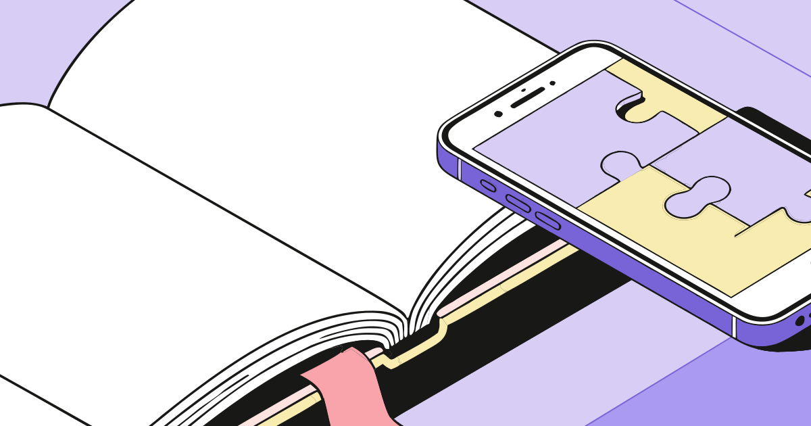
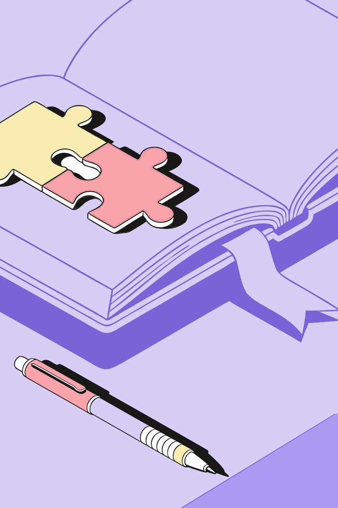

# illustrations

Сервис собирает иллюстрации из фиксированной библиотеки SVG: на входе тема или список предметов, на выходе готовый кадр — векторный SVG или PNG, в одном из трёх форматов и одной из палитр макета.


**Демо:** https://illustrations-pink.vercel.app

## Как запустить

```bash
npm install
npm run dev      # адрес печатает сам Vite
npm test         # тесты на доменную логику
npm run build    # статика в dist/
```

Ключ к модели не обязателен: референсные сцены собираются детерминированно, без сетевого запроса. Для остальных составов предусмотрен дополнительный выбор позы через модель — `DEEPSEEK_KEY` в `.env.local`, в бандл он не попадёт.

## Что умеет

- **Готовые формулировки.** Клик по полю ввода открывает примеры для обоих сценариев: темы («обучение и курсы», «деньги и бюджет») и наборы предметов («лампа, папка, ручка»). Один клик подставляет текст, переключает режим и собирает сцену.
- **Сценарий по теме.** «Обучение и курсы», «деньги и бюджет», «музыка и подкасты» — сервис сам решает, какие предметы поставить и как их связать.
- **Сценарий по названиям.** «Лампа, папка, ручка» — сцена собирается из названных предметов, состав не подменяется.
- **Кадры и палитры.** Три формата, два размера, три схемы заказчика и свои палитры; перекрашивается вся иллюстрация целиком.
- **Ручная правка.** Перемещение, поворот ручками в углах, порядок слоёв, дублирование, замена предмета.
- **Экспорт.** SVG и PNG одним окном, без потери векторности.
- **Телефон.** Шторки вместо панелей, форматы и слои доступны на узком экране.

## Как выбирается композиция

### Сначала — композиционная схема, а не случайная расстановка

В `src/domain/compose/reference.ts` описаны шесть семейств сцен из референсов и дополнительная рабочая сцена:

| Состав | Принцип |
|---|---|
| Телефон + пазл | телефон снизу слева, отдельный пазл сверху справа |
| Книга + телефон | крупный разворот с кадрированием, телефон на странице |
| Папка + кошелёк + монета | папка сзади сверху, кошелёк снизу слева, монета отдельно |
| Наушники + ваза | наушники на переднем плане, монохромная ваза за ними |
| Кошелёк + монета + лампа | кошелёк снизу, монета справа, лампа уходит за верхний край |
| Книга + пазл + ручка | монохромная книга, пазл на странице, ручка отдельно снизу |
| Папка + ручка + лампа | папка и ручка впереди, лампа в глубине |

У каждой схемы свои координаты для квадратного, горизонтального и вертикального кадра, порядок слоёв и допустимый обрез. Поэтому смена формата — не растягивание картинки и не выбор другой случайной сцены. Варианты слегка сдвигают **всю группу**, сохраняя отношения предметов. Порядок перечисления известных объектов не меняет композицию.

Схема применяется только тогда, когда умеет разместить **все** названные предметы. Она не добавляет отсутствующие предметы и не выбрасывает лишние. Для других наборов остаётся общий движок: подходящие позы, геометрическая проверка видимости и пересечений, оценка баланса. Для больших наборов предусмотрена резервная сетка; это не обещание художественного качества для десяти предметов одновременно.

### Сценарий по теме

1. Бриф разбирается по словарю смыслов: знание, деньги, идея, порядок, ритм и другие.
2. Три наиболее сильные темы превращаются в подходящие составы. В составе нет случайной обязательной детали: к телефону не добавляется ещё одна монета просто ради заполнения.
3. Подходящая референсная схема имеет приоритет; если её нет — работает общий движок.
4. Кандидаты проходят проверку. Намеренный обрез крупных книги и папки задаётся схемой явно, а не объявляется ошибкой. Неожиданное исчезновение предмета или конфликт крупных объектов по-прежнему отбраковываются.
5. Побеждает корректный кандидат. Кнопка вариантов меняет раскладку, но не подменяет её сценой из другой темы.

Разбор метафор словарный: произвольный незнакомый заголовок может не распознаться. Тогда можно уточнить тему или воспользоваться сценарием по названиям.

### Сценарий по названиям

Названия и синонимы разбираются по словарю, поддерживаются небольшие опечатки. Известные сочетания попадают в схемы выше. В общем случае первый предмет — герой, второй — поддержка, третий — деталь, лампа и ваза в группе работают фоном. Одинокая ваза или лампа остаётся единственным предметом, без выдуманной книги. Все распознанные предметы сохраняются, в том числе в списках длиннее трёх.

### Форматы, размеры и ручные правки

При смене формата или размера пересчитываются **и сцена, и пул её вариантов**. Используется последний отправленный запрос, а не ещё не отправленный текст в поле. Нужные SVG загружаются до расчёта геометрии; устаревшая загрузка не может вернуть очищенную сцену. После ручной правки автоматическая пересборка отключается, чтобы не потерять работу пользователя.

Подложка выбирается из готовых SVG библиотеки: конфетти для телефона с пазлом и наушников, геометрия для остальных сцен. Её можно изменить в панели вида.

## Как работает ИИ

Для референсных сцен модель **не вызывается**: композицию определяет проверенная схема. Это исключает задержку запроса и случайное ухудшение кадра при повторной генерации.

Для нереференсных сцен сохранён дополнительный выбор позы через модель. Она может выбрать только название паттерна и зеркало из закрытого списка — не рисует объекты, не меняет SVG и не вычисляет геометрию. Ответ проверяется, при ошибке или отсутствии ключа остаются правила. Запрос ограничен таймаутом и кэшируется по теме и формату. Ключ доступен только серверу: в разработке — прокси Vite, на Vercel — серверная функция.

## Управление

**Мышь.** Тащишь предмет — он двигается. У выделенного предмета в углах рамки четыре ручки: тянешь — поворот вокруг центра, шаг 1°, с Shift — 15°. Правая кнопка открывает меню предмета.

**Клавиатура.** Работает с выделенным предметом:

| Клавиши | Что делают |
|---|---|
| `←` `→` `↑` `↓` | сдвиг на 0.5% кадра, с Shift — на 2% |
| `[` `]` | поворот на 5° |
| `Delete` `Backspace` | удалить предмет |
| `Ctrl/Cmd + D` | дублировать |
| `Esc` | закрыть меню |

**Меню предмета (таскбар).** Открывается правой кнопкой, на телефоне — долгим нажатием (450 мс) или двойным касанием. Пункты: дублировать, выше слоем, ниже слоем, повернуть на 15°, выпрямить, сменить тон, удалить.

**Телефон.** Палец тащит предмет и вращает его за угол рамки. Жест с холста не уходит в прокрутку и не вызывает «потянуть-обновить»: у холста отключены браузерные жесты, а у страницы — обновление по свайпу.

## Мобильная версия

На узком экране интерфейс перестраивается в три полосы: шапка, холст, нижняя панель. Боковые панели превращаются в шторки, которые выезжают снизу поверх холста, — так экран не делится на три узкие колонки.

- **Объекты** — шторка с библиотекой: тап добавляет предмет в сцену, перетаскивание тоже работает.
- **Вид** — шторка с форматом кадра, палитрами, размером, фоном и слоями. Переключатель формата живёт здесь, потому что в шапке на телефоне для него нет места.
- **Экспорт** — шторка снизу с двумя крупными карточками, SVG и PNG.

Высота шторки — 78% высоты экрана, снизу учитывается безопасная зона (домашняя полоска iPhone). Список слоёв прокручивается, панель действий идёт в общем потоке и ничего не перекрывает.

Спрайты грузятся по мере надобности: пока нужного файла нет, холст держит индикатор, а плитки библиотеки остаются пустыми рамками и заполняются сами.

## Как устроено

### Хранение

Исходники макета лежат как есть: `assets/source` — десять предметов, каждый в цветном и монохромном состоянии и в двух размерах, плюс подложки. Над ними `manifest.json`: какой файл соответствует предмету, размеру и состоянию, плюс палитры и форматы. Библиотека выгружена из макета вручную; если макет меняется, файлы и манифест обновляются заново.

Разметка не попадает в JavaScript: при старте сборки файлы раскладываются в `public/sprites` и грузятся по одному. Сцене нужны три-четыре предмета, поэтому первая загрузка — четверть мегабайта вместо полутора.

### Извлечение

Три шага превращают файл из макета в спрайт.

**Границы.** В выгрузках Figma вокруг рисунка прозрачные поля, из-за них предмет «висит» и плитка выглядит рваной. Реальные границы снимаются через `getBBox()` один раз и кэшируются по предмету, состоянию и размеру.

**Обёртка.** Внешний `<svg>` снимается: на сцену попадает только содержимое, а размеры кадра задаёт сцена.

**Перекраска.** Цвета заменяются по роли, а не по конкретному значению: один проход строит таблицу «источник → цель» по всем базовым палитрам сразу, поэтому предмет читается верно, даже если нарисован не в той схеме, что подложка. Слотов восемь: три фона, линии, три цвета объектов, белый. Для монохромного варианта считается отдельный тон — иначе он растворяется на фоне.

### Переиспользование

Сцена — это массив слоёв, а не картинка: `{ id, kind, x, y, rot, scale }`, где `id` — предмет библиотеки, а координаты заданы в долях кадра. Отсюда два свойства: смена формата не ломает сцену, а масштаб всегда единица — предметы стоят в том размере, в котором нарисованы, и обрез краем задуман.

Экспорт собирает SVG из живого DOM: клонирует сцену, вырезает служебные слои выделения, подставляет `xmlns` и размеры кадра. В файл попадает ровно то, что видно.

## AI-инструменты

| Инструмент | Где применялся |
|---|---|
| DeepSeek Harness (агент-разработчик) | написание кода, рефакторинг, тесты, разбор ошибок и документация |
| DeepSeek V4.1 Flash через API | дополнительная интеграция выбора общей позы; для референсных сцен не вызывается |
| Claude через OpenCode | доработка композиционных схем по референсам, проверок, тестов и генератора примеров |
| Figma | не ИИ: источник библиотеки и референсов |

Новые объекты не генерируются: вся геометрия — исходные SVG из макета заказчика. Допускаются только размещение, кадрирование, слой и палитра. В сцене с лампой кошелёк получает тёплую цветовую роль, в сцене с папкой — лавандовую; контуры и пропорции при этом одинаковые.

## Примеры

Актуальная галерея: [`examples/generated/index.html`](examples/generated/index.html) — шесть составов в трёх форматах, всего **18 самостоятельных SVG**. Она воспроизводится из текущего алгоритма, а не из вручную размещённых объектов:

```bash
npm run examples
npm run dev
# открыть /examples/generated/index.html
```

Для быстрого сравнения:





Предыдущие примеры в корне `examples/` оставлены как история проекта; актуальный результат — в `examples/generated/`.

## Структура

```
src/domain     библиотека спрайтов, палитры, движок композиции
src/features   сцена, инспектор, библиотека, экспорт
src/state      состояние редактора
api            серверная функция для выбора позы (только для продакшена)
assets/source  исходные SVG из макета
examples       собранные композиции
```
